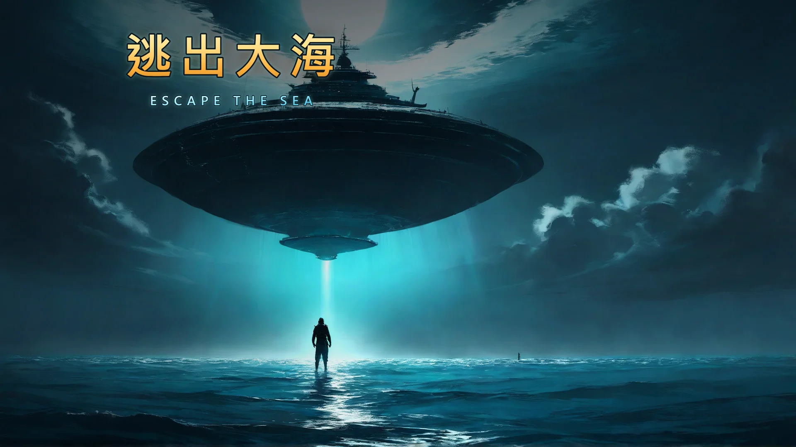
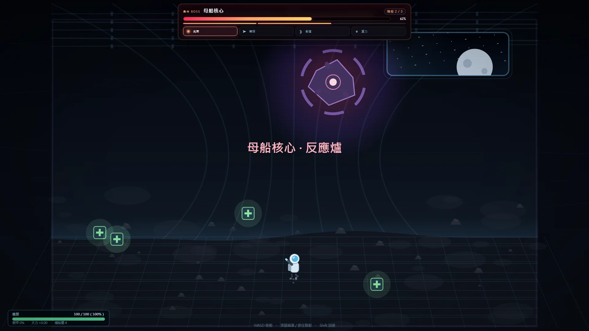

# 逃出大海 · Escape the Sea

單機 HTML5 網頁遊戲：在海灘被外星飛船巨炮打落海，被暗湧沖到大海中央。
收集海上垃圾 → 建造會長大的自動化基地 → 派出 BOT 出海 → 升級裝備 → 造太空船飛上月球 → 與外星母船決戰。

## v0.11 主線已上線

完整主線可從頭玩到結局：**四隻深海巨獸（四種模式）→ 四階段母船核心 → 90 秒逃生倒數 → 鏡像 BOSS**。破關後有 3 個挑戰模式（一命／限時 45／赤手空拳）、NG+ 0–9、24 個成就與 8 個海域事件。

- **現在就玩**：https://cchpucky1984.github.io/escape-the-sea/ （GitHub Pages，免費、免安裝；itch.io／Steam 上架準備中）
- **從原始碼跑**：下載 repo → 雙擊 `index.html`（或執行 `start.bat`）
- **GitHub Pages**：https://cchpucky1984.github.io/escape-the-sea/ （最新開發版）　·　**Steam／itch.io**：Coming soon
- **版本**：v0.11（`main` 分支）；一輪約 **75–105 分鐘（模型推估，封測後定案）**

## 系統需求

| 平台 | 需求 |
|---|---|
| 桌機 | Windows 10+／macOS 11+／Linux；Chrome、Edge、Firefox、Safari 最近 2 版；4 GB RAM；1280×800 以上；鍵盤＋滑鼠 |
| 手機／平板 | iOS 15+／Android 10+；390×844 以上；觸控（左搖桿／右射擊）；PWA 可安裝 |
| 網路 | **免安裝、免連線**；首次載入頁面需要網路（含音樂約 10MB），PWA 可離線 |
| 存檔 | 瀏覽器 `localStorage`（key：`escape-the-sea-v2`）；清除網站資料會清掉進度 |
| 不支援 | Internet Explorer、舊版 Safari（<15）、關閉 WebGL 以外的舊裝置 |

## 開始玩

雙擊 `index.html`，或執行 `start.bat`（用預設瀏覽器開啟）。
免安裝、免網絡、免伺服器。進度自動存在瀏覽器 `localStorage`（key：`escape-the-sea-v2`）。

## 授權與 AI 揭露

© 2026 cchpucky1984，**All Rights Reserved**。允許個人遊玩、分享官方頁面連結、實況／錄影／評論（需標示作品名稱與作者）；**不得**重製、散布、改作、商用或作訓練資料。完整條文見 [LICENSE](LICENSE)、第三方與 AI 素材見 [THIRD-PARTY-NOTICES.md](THIRD-PARTY-NOTICES.md)。

- **AI 美術**：key art／capsule／概念圖由 ComfyUI + `anima_pencil-XL` 生成（FAIPL-1.0-SD，輸出可商用）；**遊戲內美術 100% 程式繪製**。
- **AI 音樂**：3 段背景音樂由 ACE-Step 1.5 生成（Apache-2.0，輸出屬本作品）；音效為 WebAudio 合成。
- **AI 文字**：遊戲與商店文案由 AI 輔助起草、團隊人工編輯；執行時不生成文字。
- 未採用 `animeScreencapStyle` 的任何輸出（該模型禁止販售生成圖）。

## 商店與連結（上架中）

- **itch.io**：`[ITCH URL]` — 付費版 US$2.99（首發 −20%）；另有「前 15 分鐘試玩」免費頁。
- **Steam 願望清單**：`[STEAM URL]` — 先開頁收集關注，桌面打包在 v0.7 之後評估。
- **GitHub Pages**：`[GITHUB PAGES URL]` — 可免費直接玩最新開發版。
- 最終商店文案：[ITCH-FINAL.md](docs/marketing/ITCH-FINAL.md)　·　媒體素材：[PRESSKIT.md](docs/marketing/PRESSKIT.md)　·　隱私／授權：[LEGAL.md](docs/marketing/LEGAL.md)
- **AI 揭露**：key art 與概念圖為 ComfyUI + `anima_pencil-XL`（FAIPL-1.0-SD，輸出可商用）；音樂為 ACE-Step 1.5（Apache-2.0）；**遊戲內美術與音效全部是程式即時生成**。`animeScreencapStyle` 模型的輸出禁止商用、未採用。

## 操作

| 按鍵 | 功能 |
|---|---|
| WASD / 方向鍵 | 游動；月球內部移動；登艦時飛行 |
| Shift | 衝刺 / 月球加速 |
| 滑鼠、左鍵 | 瞄準、發射魚槍（月球：射擊） |
| 空白鍵 | 海面發射魚槍（同左鍵）；開場劇情按空白／Enter 繼續 |
| B | 自動化基地：建造新建築（平台會一格格擴張） |
| C | 裝備升級、魚槍模組、太空船組裝、發射 |
| H | 賞金合約（需先建造「賞金終端」） |
| J | 任務清單與成就 |
| Esc | 關閉面板 / 暫停選單（含音量設定） |
| M | 總靜音（音效＋音樂） |
| F2／F3（僅封測版） | F2 標記卡點、F3 顯示 FPS；Esc → 匯出測試紀錄 |
| 標題畫面 | 挑戰模式／NG+（通關後解鎖；Esc → 可及性設定） |

## 生存規則（2026 平衡版）

- **生命 3 點**：起始 3 HP，鯊魚 −2、外星無人機 −1、水母 −1。回基地安全圈即回滿。
- 每升一級潛水衣，最大生命 +1（3 → 7）。HUD 用愛心圖案顯示，不再顯示數字。
- 氧氣／體力同樣改成圖示＋條，沒有數字；氧氣見底會持續扣血，靠近基地或撿空氣泡補充。
- **一定要游回基地**才能建造、升級、發射（面板會拒絕並顯示距離）。
- **裝備房**：沒建就不能升級裝備。
- **火箭研發中心**：沒建就不能研發火箭護盾、也不能建衛星光束發生器。
- **四角守衛**：海域四個角落各一隻（深海巨獸），擊敗得「科技碎片」；集滿 4 塊才能在研發中心研發火箭護盾。
- **衛星光束發生器**（超級武器，需研發中心）：母船決戰時，核心 90% 觸發第一發光束打到 60%；10% 時第二發直接終結。

## 火箭／母船規則

- 火箭等級直接繼承你的裝備：**速度＝蛙鞋、武器＝魚槍、裝甲＝潛水衣、護盾＝研發科技**。
- **升空門檻**：魚槍 Lv3＋潛水衣 Lv2＋火箭研發中心（缺哪項會顯示在 toast）。
- 升空時艦炮自動反擊，但**魚槍等級低於 3 打不穿外星戰機護盾**；Lv3 以上兩發擊落。
- 母船內部繼承同一套升級：**魚槍 Lv4 才是 100% 傷害，Lv3 只剩 35%，Lv1–2 打不穿外星人護盾**。
- 核心掉到 50% 時人類同盟軍進場。

## CHEAT

標題畫面直接打鍵盤 `cheat`（不用按 Enter）→ 畫面震動、標題出現 **YOU CHEATER!!!**。
再按「開始遊戲」，開局會彈出免費裝備面板，全部免費、與正常升級疊加、整場有效；之後可在 Esc 暫停選單再開。作弊不會解鎖挑戰類成就。

## 核心系統

**會長大的基地**
- 起點只有一塊補給平台；每建造一座建築，平台就多一格，並自動選擇最靠近中心的位置擴張。
- 五種建築可重複建造：自動收集網、分解工坊、防禦炮塔、外星逆向工程、BOT 船塢；另有一次性關鍵建築：裝備房、火箭研發中心、火箭工坊、衛星光束發生器、賞金終端、模組工作台。
- 造價隨同類數量 ×1.6 遞增，所以擴張有節奏但不會爆走。
- 基地面板有即時小地圖、安全圈半徑、每 5 秒產出、BOT 數量。

**安全圈**
- 半徑隨平台擴張而變大（面板與 HUD 都會顯示）。
- 圈內：玩家不會受傷、氧氣與生命自動補給；敵人子彈一進入就被護盾吸收；鯊魚、無人機、水母與巨獸會被擋在外面。
- 玩家在圈內時，敵怪只會在外圍徘徊。

**BOT 艦隊**
- 每座 BOT 船塢生產一台 BOT（最多 3 台）。
- BOT 會自己出海找垃圾、載滿 8 件就回基地卸貨；找不到垃圾時會在基地附近打撈，確保有被動收入。
- 可在雷達（黃點）與畫面上（黃色小艇 + 載貨量）看到牠們。

**賞金合約**：`H` 面板（需賞金終端）3 張合約、6 秒補槽、15 金屬換牌；擊殺／打撈／巡弋／獵首都能換合金。

**魚槍模組**：模組工作台解鎖 3 槽（穿透／爆裂／電磁）；模組箱由巨獸、賞金獵首與裂縫核心掉落。

**深海巨獸**：四角各一隻（240 HP、3 階段、弱點核心），擊敗掉科技碎片與模組箱；指北針在 2000m 內顯示最近方位。

**海域事件**：每局從 8 個事件抽（垃圾潮／洋流暴衝／鯊魚群／外星巡邏／氧氣外洩／補給箱雨／暗流漩渦／守衛甦醒），第一次在第 3 分鐘、之後每 100 秒檢定。

**裝備與太空船**：蛙鞋、氧氣瓶、潛水衣、磁力收集器、壓縮魚槍各 4 級（需裝備房）；船體、引擎、燃料槽、導航電腦 4 個零件；火箭工坊 ×1 才能發射。

**任務與成就**：15 個引導任務＋24 個成就（進度 10／挑戰 8／彩蛋 6），HUD 顯示進度、J 看全表；成就只給記錄，不給數值獎勵。

## 流程

1. **大海收集** → 2. **建基地與 BOT** → 3. **升級裝備** → 4. **組裝太空船**
5. **升空**：A/D 閃隕石、W 加速；外星戰機會來攔截，艦上防禦炮自動反擊。
6. **登艦**：母船就在月球軌道上。WASD 飛行，按住 W 衝進機庫入口（母船引力會把你往後拉）。
7. **母船內部**：兩波守軍 → 反應爐核心（艙壓制）。核心掉到 50% 時，地球同盟軍第三艦隊會殺進來跟你一起打。
8. **結局**：核心爆炸，同盟軍護著你的逃生艙離開。

## 海域風險／回報

離基地越遠，垃圾越肥、怪物越多越兇（HUD 會顯示當前海域）：

| 海域 | 距離 | 資源 | 怪物上限 |
|---|---|---|---|
| 近海 | < 800 | ×1 | 2 |
| 外海 | 800–1600 | ×1.3 | 4 |
| 深海 | 1600–2600 | ×1.6 | 6 |
| 遠洋 | 2600+ | ×2.0 | 8 |

遠洋的怪移動更快、開火更密；一趟的收入約是近海的 2 倍。

死亡：在基地復活，失去 15% 塑膠。升空／登艦失敗：回基地修理（金屬 -8）。母船戰敗：可再次出擊。

## v0.11（本輪）

- **發售整備**：`LICENSE`（All Rights Reserved）＋ `THIRD-PARTY-NOTICES`、`CHANGELOG`（v0.3→v0.11）、最終 itch 頁文案 `ITCH-FINAL.md`、`RELEASE-NOTES-v0.11.md`、社群發佈包 `SOCIAL-LAUNCH-v0.11.md`。
- **商店素材**：wordmark、1920×1080 英雄圖、5 張 1920 實機截圖、玩法 3 步驟資訊圖（`docs/art/store/`）。
- **平衡模型**：首輪中位推估 **75 分**（±25%；目標 90–150），已提 L1 護盾 gate／L2 登艦走廊／L3 賞金 T3 三個「加內容不加 grind」槓桿；封測＋新 `balance.mjs` log 後定案（`BALANCE-v0.11.md`）。
- **修正**：海面繪製效能收尾＋低 fps 自動降級；QA 47/47、pageErrors 0。

## v0.10（上一輪）

- **封測工具**：F2 標記卡點、F3 顯示 FPS、Esc → 匯出 `testlog.json`（版本／進度／設定／標記／FPS；**不含個資**，見 `LEGAL.md` §2.5）。
- **上架彩排**：`docs/marketing/ITCH-ROLLOUT.md`（逐步操作＋私密 beta 流程＋上線後 24h 清單）；外聯信在 `OUTREACH.md`（5 家 press 中英模板）。
- **法務更新**：AI 揭露擴充到「美術／音樂／文字」三段（`LEGAL.md` §4.2）；封測資料邊界寫清楚（§2.5）。
- **i18n**：`STRINGS.js` 增至 **555 條**（新增封測工具／QA 面板 21 條）。
- **效能**：headless 30–37fps；實機 60fps 與 iOS/Android 觸控仍是上架 gate（見 HANDOFF §4）。

## v0.9（更早）

- **挑戰模式 3**：通關一次後從標題進入——一命深海（死亡即結束）、限時 45（45 分鐘內攻入核心）、赤手空拳（不建砲塔／不裝模組／四裝備不可升級）。不能存檔，最佳分寫在獨立 key。
- **NG+**：通關後進下一輪（上限 NG+9）；重置資源／裝備／基地／零件，保留成就、挑戰最佳分、巨獸擊殺。敵人 HP +25%·ng、傷害 +10%·ng、產出 +15%·ng。
- **可及性**：減少動態（震動／閃光／粒子）、色盲輔助（形狀＋文字）、字級 100%／120%，重開保留。
- **平衡**：最終核心 HP 900 → 1800，核心 TTK 目標 70–100 秒、含波次＋逃生＋鏡像的整場決戰 5–7 分鐘；首輪目標 90–150 分鐘（v0.11 模型推估中位 75，待平衡槓桿與實測定案）。
- **i18n**：`docs/i18n/STRINGS.js` 增至 540 條（挑戰／NG+／可及性／canvas 海域名短版）；v0.10 再加封測工具 21 條至 555。

## v0.8（更早）

- **難度提升**：海域密度（深海同屏上限 6→10、遠洋 8→12）；四巨獸四模式（光束／追蹤／衝撞／洋流）；子彈四型（快／慢／追蹤／雷射）各附前搖與躲法。
- **最終戰重做**：升空可手動瞄準；母船第 2 波 10→24；核心 900HP 四階段（重力→光束→導彈→衝撞）；核心死後 90 秒逃生倒數＋鏡像 BOSS（同型態、技能 +1，擊敗才通關）；`#dockcue` 轉場提示與雙血條。

## v0.7（更早）

- **手機觸控**：390×844 直向可玩——左半虛擬搖桿游動、右半瞄準／射擊，面板維持可點（施工中）。
- **PWA**：manifest＋service worker，可安裝到桌面、離線開啟；快取與 `?v=` 同步，更新會換版（施工中）。
- **英文介面**：`docs/i18n/STRINGS.js`（425 條＋模板）已備好；英文用語收斂表 `docs/i18n/EN-REVIEW.md`（36 概念唯一譯法＋20 條縮短版）；設定裡的 EN 接完才開。
- **發佈包**：`docs/marketing/LAUNCH-KIT.md`（itch 上架檢查表、Steam 願望清單待補、X／Reddit／巴哈中英貼文、5 個 press 名單）。
- 待辦：挑戰模式／NG+／教學、Steam 打包、商店 1920 截圖與預告。

## v0.6（更早）

- **標題畫面**：key art 換成原生 1920×1080（`docs/art/title-art/`，CSS 接線、載入失敗回退程序背景）。
- **背景音樂**：3 場景 × 2 候選（`docs/audio/`，ACE-Step、-18 LUFS、無縫循環）；已接 `MUSIC`（`setScene` 切換、音量可調）。候選仍需人耳驗收。
- **成就 24**：J 面板第二區（全部／進度／挑戰／彩蛋分頁），toast「成就解鎖」；不給數值獎勵。
- **海域事件 8**：`js/events.js`，首次 3 分鐘、之後每 100 秒；同時最多 1 個、冷卻 30 秒。
- **設定面板**：音樂／音效音量、總靜音、減少動態、語言（英文顯示 soon，v0.8）。
- **i18n 字典**：`docs/i18n/STRINGS.js`（`window.I18N_DATA`，425 條＋17 個動態模板＋複數規則），B 接線中。
- 待辦：挑戰模式 3 個、NG+、教學 5 步（設計已定案，接線中）；英文介面 v0.8；商店頁與預告素材（見 `docs/marketing/`）。

## 檔案

- `index.html` 入口　·　`style.css` 介面　·　`start.bat` 本機啟動
- `js/core.js` 狀態 / 存檔 / 資源 / 面板 / 任務 / 成就 / 音樂 / 設定
- `js/fx.js` 粒子、鏡頭震動、漸層快取、合成音效
- `js/base.js` 基地平台、安全圈、BOT、砲塔、建築繪製
- `js/sea.js` 大海場景（收集、敵人、雷達、指北針、賞金合約）
- `js/events.js` 海域事件（8 個）與深海裂縫
- `js/leviathan.js` 深海巨獸 AI／3 階段／弱點核心／掉落
- `js/space.js` 升空、登艦與月球決戰
- `js/main.js` 輸入、場景切換、主迴圈

## 文件索引

- [docs/PRODUCT-v1.0.md](docs/PRODUCT-v1.0.md) — 商業級品質標準（六支柱＋里程碑）
- [docs/HANDOFF.md](docs/HANDOFF.md) — 交接文件（暫停點、已知問題、下次開工順序）
- [LICENSE](LICENSE) — 授權條文（All Rights Reserved）　·　[THIRD-PARTY-NOTICES.md](THIRD-PARTY-NOTICES.md) — 第三方與 AI 素材揭露
- [docs/design/GDD-v0.4.md](docs/design/GDD-v0.4.md) — v0.4 企劃定案：賞金海域、數值、驗收
- [docs/design/CONTENT-v0.5.md](docs/design/CONTENT-v0.5.md) — 內容深度：成就 24／挑戰 3／事件 8／教學／NG+ 規格
- [docs/design/DIFFICULTY-v0.8.md](docs/design/DIFFICULTY-v0.8.md) — 難度與最終戰施工規格（四巨獸／彈幕／核心四階段／鏡像）
- [docs/design/BETA-PLAN.md](docs/design/BETA-PLAN.md) — 8 人封測計劃（招募／腳本／問卷／指標）
- [docs/tech/AUDIT-v0.4.md](docs/tech/AUDIT-v0.4.md) — 架構與技術債審查
- [docs/art/STYLE-v0.4.md](docs/art/STYLE-v0.4.md) — 視覺風格與 HUD／面板規格
- [docs/art/TITLE-ART.md](docs/art/TITLE-ART.md) — 標題 key art 接線規格；素材見 [AI-ASSETS-v0.5.md](docs/art/AI-ASSETS-v0.5.md)
- [docs/audio/AUDIO-SPEC.md](docs/audio/AUDIO-SPEC.md) — 背景音樂規格、候選與接線說明
- [docs/vfx/VFX-AUDIO-v0.4.md](docs/vfx/VFX-AUDIO-v0.4.md) — 打擊感、粒子與音效設計
- [docs/content/LEVELS-v0.4.md](docs/content/LEVELS-v0.4.md) — 海域事件、守衛、數值與任務擴充
- [docs/marketing/CHANGELOG.md](docs/marketing/CHANGELOG.md) — 更新紀錄（v0.3→v0.11，中英）
- [docs/marketing/ITCH-FINAL.md](docs/marketing/ITCH-FINAL.md) — itch.io 最終頁文案（短／長描述、6 特色、12 標籤、FAQ）
- [docs/marketing/RELEASE-NOTES-v0.11.md](docs/marketing/RELEASE-NOTES-v0.11.md) — v0.11 發佈說明（中英）
- [docs/marketing/SOCIAL-LAUNCH-v0.11.md](docs/marketing/SOCIAL-LAUNCH-v0.11.md) — X thread／Reddit／巴哈發佈包與 3 張截圖
- [docs/design/BALANCE-v0.11.md](docs/design/BALANCE-v0.11.md) — 首輪長度重算與三個平衡槓桿
- [docs/marketing/STORE-v0.6-EN.md](docs/marketing/STORE-v0.6-EN.md) — 英文商店頁（itch＋Steam）與 AI 揭露
- [docs/marketing/STORE-v0.5.md](docs/marketing/STORE-v0.5.md) — 中文商店頁與素材清單
- [docs/marketing/TRAILER-v0.6.md](docs/marketing/TRAILER-v0.6.md) — 30 秒預告分鏡與重現指令
- [docs/marketing/DEVLOG-02.md](docs/marketing/DEVLOG-02.md) — Devlog #2（音樂／成就／事件／標題）
- [docs/marketing/DEVLOG-03.md](docs/marketing/DEVLOG-03.md) — Devlog #3（觸控／PWA／英文）
- [docs/marketing/DEVLOG-04.md](docs/marketing/DEVLOG-04.md) — Devlog #4（挑戰／NG+／可及性／核心 1800）
- [docs/marketing/LAUNCH-KIT.md](docs/marketing/LAUNCH-KIT.md) — 上架檢查表、Steam 待補、社群貼文、press 名單
- [docs/marketing/ITCH-ROLLOUT.md](docs/marketing/ITCH-ROLLOUT.md) — itch 上架逐步彩排、私密 beta 流程、上線後 24h 清單
- [docs/marketing/OUTREACH.md](docs/marketing/OUTREACH.md) — 5 家 press／KOL 中英模板信、寄送時程、追蹤表
- [docs/marketing/PRESSKIT.md](docs/marketing/PRESSKIT.md) — 媒體素材包與事實表
- [docs/marketing/LEGAL.md](docs/marketing/LEGAL.md) — 隱私、AI 揭露、字型／音樂／模型授權清單
- [docs/i18n/STRINGS.js](docs/i18n/STRINGS.js) — zh-Hant → en 字典（555 條，可直接載入）
- [docs/i18n/EN-REVIEW.md](docs/i18n/EN-REVIEW.md) — 英文用語一致性（50 條）＋20 條過長字串縮短版
- [docs/i18n/STRINGS.md](docs/i18n/STRINGS.md) — 翻譯慣例與歷史對照
- [docs/qa/QA-BASELINE.md](docs/qa/QA-BASELINE.md) — QA 基準線與已知問題
- [docs/TEAM.md](docs/TEAM.md) — 團隊規範與檔案擁有權

## English

**Escape the Sea** is a single-player HTML5 survival / base-building game: an alien ship blasts you into the ocean, and you turn floating trash into a growing offshore base, a BOT fleet, and finally a spacecraft to take the fight to the alien mothership.

- **Play on itch.io**: `[ITCH URL]` (free 15-minute demo: `[DEMO URL]`; full version US$2.99 TBD)
- **Play locally**: open `index.html` (or run `start.bat`). No install, no network, no account.
- **Controls**: WASD/Arrows swim · Shift sprint · Mouse aim/fire · B base · C gear · H bounties · J quests · Esc pause/settings · M mute.
- **Loop**: collect trash → grow the platform base → send out BOTs → upgrade gear → build a spacecraft → storm the mothership.
- **Status**: v0.11 mainline is playable end to end — four patterned leviathans, a four-phase core, a 90-second escape countdown and a Mirror Core (+1 skill). Plus 3 challenge modes, NG+ 0–9, 24 achievements, 8 sea events, EN/zh-Hant. Run length is a model estimate (~75–105 min) until beta.
- **Requirements**: Windows/macOS/Linux with a recent Chrome, Edge, Firefox or Safari; 1280×800+; keyboard and mouse. Mobile: iOS 15+/Android 10+, 390×844+, touch, installable PWA. No install needed.
- **License**: © 2026 cchpucky1984, All Rights Reserved — see [LICENSE](LICENSE) and [THIRD-PARTY-NOTICES.md](THIRD-PARTY-NOTICES.md).
- **Beta builds**: optional diagnostic export (`testlog.json`) contains game state only — no names, emails, IPs or device fingerprints. See [LEGAL.md](docs/marketing/LEGAL.md) §2.5.
- **Privacy**: no accounts, no tracking; progress stays in your browser's `localStorage`. See [LEGAL.md](docs/marketing/LEGAL.md).
