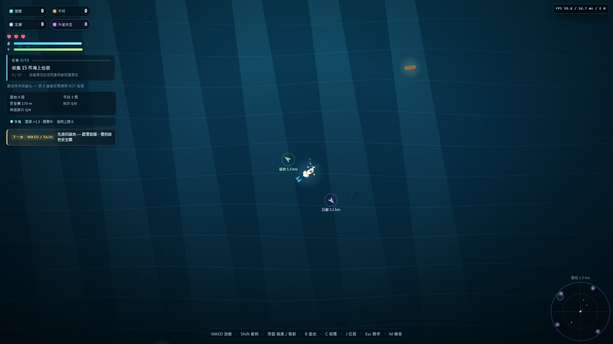

# v0.11 itch 上架定稿包

> 目錄：`docs/art/store/itch/`。全部檔案 ≤400KB；JPEG 為 itch 相容格式。
> 截圖來源：`_shots/C12/`（5 張皆 v0.10 實際 UI；BOSS 文字已由 D 修正）。
> itch 上傳順序建議：cover → screenshot 01 → 02 → 03 → 04 → 05 → icon →（banner 選用）。

## 1. Cover

| 檔案 | 尺寸 | 大小 | 用途／說明 |
|---|---|---|---|
| `itch/cover-630x500.jpg` | 630×500 | 45.7 KB | itch 商店封面；key art 中央裁切＋金框 wordmark |

## 2. Screenshots（1920×1080）

| # | 檔案 | 大小 | 展示什麼 | 來源 |
|---|---|---|---|---|
| 01 | `itch/screenshot-01-challenge-menu.jpg` | 91.9 KB | 挑戰模式：一命深海／限時 45／赤手空拳，難度色＋最佳分 | `_shots/C12/01-challenge-menu-1920.png`（v0.10 實際 UI） |
| 02 | `itch/screenshot-02-fps-panel.jpg` | 155.1 KB | 海面探索＋F3 FPS 面板（QA 版） | `_shots/C12/02-fps-panel-1920.png`（v0.10 實際 UI） |
| 03 | `itch/screenshot-03-ngplus-ending.jpg` | 122.9 KB | NG+3 結局：NG+ badge、開始 NG+4、金框結算 | `_shots/C12/03-ngplus-ending-1920.png`（v0.10 實際 UI） |
| 04 | `itch/screenshot-04-boss-final.jpg` | 163.5 KB | 母船核心最終 BOSS：多階段血條、階段 1/4、四招 UI | `_shots/C12/04-boss-final-1920.png`（v0.10 實際 UI） |
| 05 | `itch/screenshot-05-mirror-boss.jpg` | 166.5 KB | 鏡像 BOSS：技能 +1 對比卡、玩家 vs 鏡像 | `_shots/C12/05-mirror-boss-1920.png`（v0.10 實際 UI） |

> 內部備註：FPS 面板截圖的數值為示意（headless 軟體渲染實際約 20fps；正式上架可換實機 60fps 截圖）。`04/05` 已是 v0.10 實際 BOSS UI（bossui 文字已由 D 修正）。

## 3. Icon

| 檔案 | 尺寸 | 大小 | 用途 |
|---|---|---|---|
| `itch/icon-512.png` | 512×512 | 288.7 KB | itch 商店 icon（與 PWA icon 相同） |

## 4. Banner（可選）

| 檔案 | 尺寸 | 大小 | 用途 |
|---|---|---|---|
| `itch/banner-1920x480.jpg` | 1920×480 | 81.7 KB | itch 頁面頂部 banner（可選） |

## 5. 合規檢查

- [x] cover 630×500（itch 建議）
- [x] screenshot 5 張 1920×1080
- [x] icon 512×512
- [x] 全部 ≤400KB（最大 288.7KB）
- [x] JPG/PNG 格式（無 WebP 相依）
- [ ] 英文版截圖（目前全中文 UI；英文商店頁可另拍）
- [ ] 實機 60fps 版 FPS 截圖（現為示意數值）

## 6. 相關
- Steam 尺寸檢查：`STEAM-CAPSULE-CHECK.md`
- 舊的 v0.9 商店截圖仍在 `docs/art/store/screenshots/`（保留作歷史／備用）。
